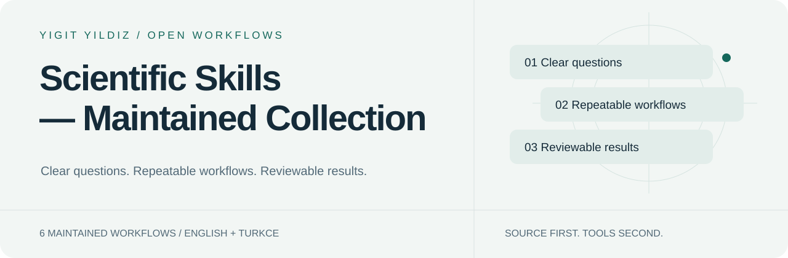

<picture>
  <source media="(prefers-color-scheme: dark)" srcset="assets/hero-dark.svg">
  
</picture>

# Scientific Skills — Maintained Collection

[English](README.md) · [Türkçe](README.tr.md)

    

**Maintained scientific workflows for literature, study, analysis, AI research and document quality.**

6 maintained entry points. Choose one for the job; do not load the entire library into context.

[Start here](docs/INSTALL.md) · [Browse the catalog](https://yigityildiz0.github.io/universal-ai-skill-library/) · [Downloads](DOWNLOADS.md) · [Maintenance model](MAINTAINING.md)

## New in 2026.10.14.3

- academic-study-coach, office-docs-qa, design and design-system now hand deck building to presentation-studio (fixes a broken PPTX QA link).
- Gemini packages (CLI folders and filtered Gemini app uploads), an installation table for every app and a real GitHub Release with SHA-256 checksums.
- One ZIP per skill for every app, never split into parts; Claude gets grouped bulk-upload ZIPs on the Desktop edition.
- Claude.ai upload fix: large skills stay ONE skill under the 200-file limit (supporting files packed in resources.zip inside the skill).

## Works with

| App | Package |
|---|---|
| Claude Code | portable folder → ~/.claude/skills |
| Claude.ai | one upload ZIP per skill |
| Codex / ChatGPT desktop | Codex.zip → ~/.codex/skills |
| ChatGPT web | plugin ZIP where the account offers import |
| Gemini CLI / app | ~/.gemini/skills · Skills upload (filtered copy) |
| OpenCode · DeepSeek Harness | portable folder + skills path |

Step-by-step: [Installation](docs/INSTALL.md). A file on disk is not proof of activation; test with one example request.

## Start with the work you want to do

<strong>Learn & write</strong> · 2

| Skill | What it helps with |
|---|---|
| [academic-study-coach](docs/skills/academic-study-coach.en.md) | Turn course material into a study plan, active recall and literature-reading practice. |
| [office-docs-qa](docs/skills/office-docs-qa.en.md) | Check document structure, content and presentation with explicit verification boundaries. |

<strong>Research & analyze</strong> · 3

| Skill | What it helps with |
|---|---|
| [ai-research-skills](docs/skills/ai-research-skills.en.md) | Navigate a broad ML engineering library for training, RAG, evaluation and experiments. |
| [data-analyst](docs/skills/data-analyst.en.md) | Analyze data with explicit units, missingness, assumptions and uncertainty. |
| [research-analyst](docs/skills/research-analyst.en.md) | Coordinate quick or deep research, claim verification, synthesis and timestamped video analysis. |

<strong>Health & rehabilitation</strong> · 1

| Skill | What it helps with |
|---|---|
| [medical-evidence-research](docs/skills/medical-evidence-research.en.md) | Search, appraise and synthesize medical evidence, including rehabilitation and Türkiye applicability. |

## What happens when a skill runs?

~~~mermaid
flowchart LR
 A[Your goal] --> B[Match the skill]
 B --> C[Load relevant module]
 C --> D[Use available tools]
 D --> E[Verify and explain]
~~~

This is the workflow, not a claim that tools ran or every result is verified. Each skill page explains an example request, trigger, mechanics, inputs/outputs and source modules.

## One source. Durable collections.

The canonical source is [Universal AI Skill Library](https://github.com/yigityildiz0/universal-ai-skill-library). Domain repositories are selected views of the same release—not independently edited forks. Existing links and history stay intact.

[All collections / Tüm koleksiyonlar](COLLECTIONS.md) · [Legacy/community resources](LEGACY.md) · [Licenses & provenance](docs/LICENSE-SCOPE.md)

## Honest scope

- Installing a skill does not train a model or connect an account/tool.
- Local files and a web-account import are different; follow the supported host flow.
- No automatic extra billed API or model download.
- The historical community catalog is not counted as maintained or claimed as runtime-tested.
- Source licenses remain attached; no blanket third-party license is assumed.

---
Maintained by [Yigit Yildiz](https://github.com/yigityildiz0) · Source edition 2026.10.14.3
